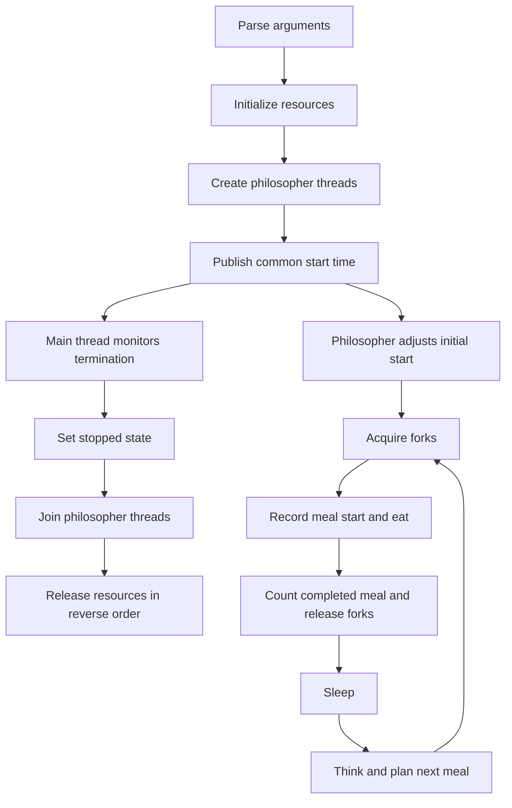

*This project has been created as part of the 42 curriculum by jinsekan.*

# Philosophers

## Description

Philosophers is a C implementation of the dining philosophers problem, built to
explore threads, mutexes, shared state, and resource contention. Philosophers sit
around a circular table and alternate between eating, sleeping, and thinking.
Each needs both adjacent forks to eat, and each fork can have only one owner.

This repository implements the mandatory, thread-based program `philo`. Each
philosopher runs in a separate POSIX thread; the main thread monitors termination.
The simulation ends when a philosopher dies or, when a meal target is supplied,
all philosophers have completed at least that many meals.

The implementation combines ordered fork acquisition with a timing policy that
uses neighboring philosophers' shared activity records to estimate a suitable
next meal time. There is no separate manager thread: each philosopher executes
the scheduling functions itself.

## Instructions

### Requirements and compilation

A Unix-like environment with a C compiler (`cc`), Make, and POSIX threads is
required. No external library or separate installation step is needed.

Run from the repository root:

```sh
make
```

The Makefile produces `philo` using `-Wall -Wextra -Werror -pthread`.

| Command | Effect |
| --- | --- |
| `make` | Build the executable |
| `make clean` | Remove object files listed by the Makefile |
| `make fclean` | Remove those object files and the executable |
| `make re` | Clean and rebuild |

### Execution

```text
./philo number_of_philosophers time_to_die time_to_eat time_to_sleep [number_of_times_each_philosopher_must_eat]
```

All arguments must be positive integers representable as a signed `long long`.
Time arguments are in milliseconds.

| Argument | Meaning |
| --- | --- |
| `number_of_philosophers` | Number of philosophers and forks |
| `time_to_die` | Maximum interval from simulation start or the last meal start until the next meal must begin |
| `time_to_eat` | Time spent eating while holding both forks |
| `time_to_sleep` | Time spent sleeping after eating |
| `number_of_times_each_philosopher_must_eat` | Optional number of completed meals required from every philosopher |

Examples:

```sh
# Run until a death occurs; Ctrl+C can interrupt the process.
./philo 5 800 200 200

# Stop when every philosopher has completed at least three meals, or on a death.
./philo 5 800 100 100 3

# A single philosopher can take only one fork and cannot eat.
./philo 1 200 60 60
```

Logs contain elapsed milliseconds since the common start, the philosopher ID
(starting at 1), and an action:

```text
timestamp_in_ms X has taken a fork
timestamp_in_ms X is eating
timestamp_in_ms X is sleeping
timestamp_in_ms X is thinking
timestamp_in_ms X died
```

The ordering and timestamps depend on thread scheduling. A simulated death is a
normal termination condition and does not itself produce a nonzero process exit
status. Invalid arguments and initialization failures return a nonzero status.

## Architecture

| Location | Responsibility |
| --- | --- |
| [main.c](main.c) | Validate argument count and start the program |
| [philo.h](philo.h) | Define shared types and function interfaces |
| [base/](base/) | Parse arguments, initialize and release resources, handle time, waits, and logs |
| [simulation/](simulation/) | Create and join threads, acquire forks, execute actions, and calculate meal timing |
| [monitor/](monitor/) | Track the earliest starvation deadline and detect termination |

### Data ownership

`t_data` owns the configuration, shared state, philosopher array, and fork mutex
array. Each `t_philo` references the configuration through `const t_share *` and
the shared runtime state through `t_state *`.

| Type | Purpose |
| --- | --- |
| `t_share` | Configuration that remains unchanged during execution |
| `t_state` | Common start time, running flag, meal-target count, earliest-deadline philosopher, and synchronization |
| `t_philo` | Thread handle, identity, meal history, current action, planned wake time, and adjacent fork pointers |
| `t_fork_state` | Observed fork owner and eating start time for timing estimates |
| `t_plan` | Temporary blocked intervals and candidate meal start times |
| `t_resource` | Initialization and cleanup function pair |

The `stop` field uses `1` for running and `0` for stopped. The per-philosopher
`meal` mutex is currently initialized and destroyed, but meal records are protected
by `state.mx`; the individual mutex is not used by the execution paths.

### Execution lifecycle



Threads wait until the common start time is published. All initial `last_meal`
values are set to that time, so creating threads sequentially does not give them
different starvation baselines. Even-numbered philosophers also wait 1 ms before
initial scheduling when `time_to_die` is greater than 2 ms.

Resources are initialized through a table of function pairs in
[base/resource.c](base/resource.c). Recursive calls advance through initialization;
returning through those calls releases successfully initialized resources in
reverse order. Individual initializers handle their own partial failures.

### Fork acquisition and synchronization

Philosopher `id` uses fork indices `id - 1` and `id % N`. Every philosopher
acquires the lower-indexed fork first. For the last philosopher, this means taking
the right fork before the left. The common ordering prevents a circular wait
between fork mutexes.

The single-philosopher case takes its only fork and waits for termination instead
of trying to lock the same mutex twice.

| Mutex | Protected data or operation |
| --- | --- |
| Each fork mutex | Exclusive possession of that fork |
| `state.mx` | Mutable simulation records, including meals, actions, fork observations, and termination |
| `state.print` | Serialized output and ordering of the death announcement |

Fork observation records support predictions; actual ownership is enforced by
the fork mutexes. Observing two free forks does not reserve them.
Output paths acquire `state.print` before `state.mx` when both are needed.
The monitor sets the stopped state while holding the output mutex before printing
a death, preventing subsequent ordinary action messages.

### Meal timing policy

[manager_model.c](simulation/manager_model.c) calculates a nominal meal period.
For `N` philosophers, eating time `E`, sleeping time `S`, and starvation time `D`:

```text
K      = floor(N / 2)
base   = max(ceil(N * E / K), E + S)
period = base + min(floor((D - base) / 2), 25)
```

`K` is the maximum simultaneous eating capacity. The period combines a
capacity-based lower bound with the philosopher's eating and sleeping duration,
then adds a bounded margin. If `K` is zero, guarded arithmetic cannot be performed,
or `base >= D`, the policy uses a fallback path.

Initial start times use:

```text
rank  = ((id - 1) * ceil(N / 2)) % N
start = common_start + floor(rank * period / N)
```

For odd `N`, ranks are distinct; for even `N`, they form two alternating groups.

[manager_select.c](simulation/manager_select.c) subsequently aims for
`last_meal + period`, limited to the range from the current time to
`max(now, last_meal + D - 2)`. It collects up to four current or predicted eating
intervals from the two neighbors and compares up to eleven candidate starts:
the target, now, the latest permitted time, and the starts that place a meal
immediately before or after each blocked interval.

Among valid candidates, it chooses the one nearest the target, preferring an
earlier time on a tie. If none is valid, it retains the target. After waiting,
[manager_plan.c](simulation/manager_plan.c) checks actual fork observations again.
The fallback path estimates fork release times and can yield briefly to a neighbor
whose last meal was earlier, subject to the philosopher's remaining time budget.

This policy reduces contention through estimates. It does not establish binding
reservations or guarantee starvation freedom; fork mutex ordering provides the
underlying protection against circular wait.

### Monitoring and shutdown

`last_meal` is updated when eating starts. `meal_cnt` increases only after the
eating wait completes successfully. Each philosopher contributes to `full_count`
once, on first reaching the requested meal target, and continues its routine until
the simulation stops.

`state.oldest` points to a philosopher with the earliest last-meal timestamp.
Since all philosophers share the same `time_to_die`, this also identifies the
earliest starvation deadline. When that philosopher starts eating, the array is
scanned to select the new oldest. Monitoring checks this pointer in constant time;
reselecting it takes linear time.

Action waits consider both the requested end time and the earliest starvation
deadline. The monitor bounds each requested sleep to at most 10 ms. These are
timing policies, not a hard real-time guarantee: scheduler delays and output
blocking can affect observation times. Time is measured using `gettimeofday()`,
so the calculations also assume the system clock does not move backward.

After termination, workers return their held forks and mark themselves released.
The main thread joins the workers before normal resource cleanup.

## Checks

```sh
make
make                 # Should not recompile or relink without changed inputs.
norminette           # Requires a separately installed Norminette.
./philo 1 200 60 60
./philo 2 800 100 100 3
./philo 5 800 100 100 3
```

The single-philosopher example exercises starvation; the two other examples
exercise meal-target termination with even and odd populations. These basic
checks do not replace repeated timing tests or a data-race analysis.

## Resources

- **42 Philosophers subject, version 13.0**: the supplied assignment PDF defines
  the mandatory behavior, permitted functions, output format, and README format.
- [Linux man-pages: pthread_create](https://man7.org/linux/man-pages/man3/pthread_create.3.html)
  — thread creation and entry functions.
- [POSIX Programmer's Manual: pthread_mutex_lock](https://man7.org/linux/man-pages/man3/pthread_mutex_lock.3p.html)
  — mutex ownership, blocking, and unlocking rules.
- [Linux man-pages: pthread_join](https://man7.org/linux/man-pages/man3/pthread_join.3.html)
  — waiting for worker termination before cleanup.
- [Linux man-pages: gettimeofday](https://man7.org/linux/man-pages/man2/gettimeofday.2.html)
  — the wall-clock time source used by this implementation.

### AI use

AI assistance was used to fix Norminette issues, split meal-planning functions
into smaller helpers, simplify the fork-availability check, analyze the current
architecture, and draft this README from the supplied subject and source code.
The affected code includes `philo.h`, `Makefile`, `simulation/manager_model.c`,
`simulation/manager_plan.c`, `simulation/manager_select.c`, and
`simulation/simulation_state.c`. The assistance also included correcting a
`const` mismatch and running build and basic execution checks. This describes
the assistance in this session and does not assert an earlier development history.
