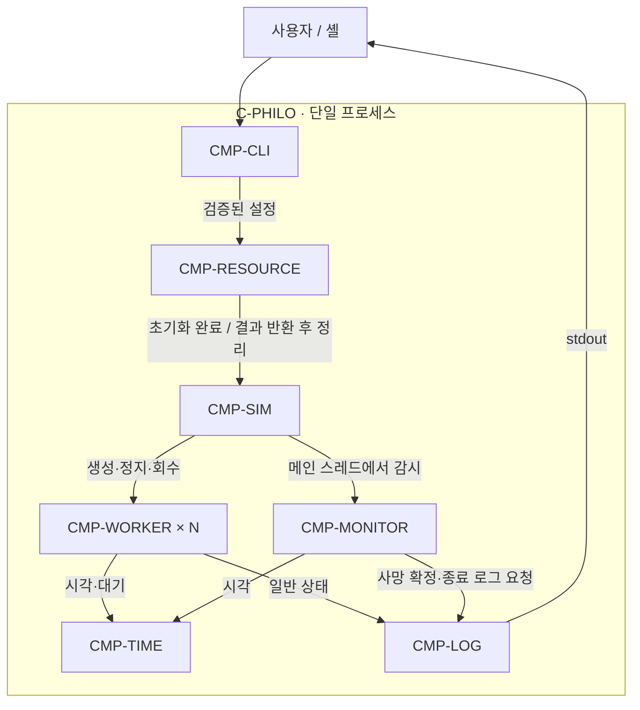

# C-PHILO · Philosophers 실행 프로그램

- 구현 상태: 부분 구현.
- 설계 단계: Container 경계·Component 책임·인터페이스 초안.
- 아래 목표 계약은 미구현. 기존 코드의 동작 보장과 구분.

## 목적과 경계

- 철학자 수·시간·식사 목표를 입력받아 식사 시뮬레이션 실행.
- Container 1개: C / pthread 기반 `philo` 프로세스.
- 메인 스레드 1개: 초기화·생성·감시·정지·회수 조정.
- worker N개: 철학자별 행동 수행. 별도 감시 스레드는 두지 않는 설계안.
- 외부 연동: 셸 입력, stdout 로그, 프로세스 종료 코드, POSIX / C 런타임.
- 영속 저장소·네트워크 통신 없음.
- 입력: `philo <count> <die_ms> <eat_ms> <sleep_ms> [must_eat]`.
- 실행 파일명·ms 단위는 목표 계약. Makefile·시간 함수 미구현.

## 내부 Component · L3

| ID | 책임 | 제외 책임 | 현재 코드 / 상태 |
| --- | --- | --- | --- |
| CMP-CLI | 인자 검증·기본 상태 준비·최종 결과 반환 | 스레드·mutex 제어 | `main.c`, `base/utils.c`, `base/init.c:init_data` / 로직 존재 |
| CMP-RESOURCE | 자원 할당·초기화·실패 롤백·역순 정리 | 종료 판정·스레드 회수 | `base/resource.c`, `base/init.c`, `base/free.c` / 로직 존재 |
| CMP-SIM | 시작 준비·생성 수 추적·감시 호출·정지·회수 | 행동 구현·직접 출력 | `philosophers.c`, `create_philo.c`, `join_philo.c` / 골격 |
| CMP-WORKER | 포크 획득·식사·반환·수면·생각·종료 처리 | 전체 종료 판정·자원 해제 | `philo_routine.c` / 미구현 |
| CMP-MONITOR | 사망·전체 식사 목표 판정 | 생성·회수·자원 해제 | 미구현 / 메인 스레드에서 호출 |
| CMP-TIME | 공통 시각·정지 가능한 시간 대기 | 사망 판정·로그 출력 | 미구현 / 파일명 미정 |
| CMP-LOG | 상태 로그 직렬화·정지 이후 일반 로그 차단 | 자원 수명주기·식사 상태 변경 | 미구현 / 파일명 미정 |

- Component는 논리 책임 단위. C 파일·pthread·mutex와 일대일 대응 불필요.
- 기존 네 Component ID 유지. 감시·시간·출력 책임만 추가 분리.

- 화살표는 호출·협력 관계. 자원 소유권은 아래 표로 별도 정의.
- POSIX 호출: SIM의 pthread 생성·회수, WORKER의 포크 잠금, TIME의 시간·대기.
- 공유 데이터 접근은 Component 간 함수 호출과 별개로 동기화 필요.

## 인터페이스 초안

| 경계 | 입력 | 결과·사후 조건 |
| --- | --- | --- |
| CLI → RESOURCE: `start_philo` | 검증된 `t_data *` | 초기화·실행·정리 결과 반환 |
| RESOURCE → SIM: `run_simulation` | 초기화된 자원 | 모든 worker의 공유 자원 접근 종료 확인 후 반환 |
| SIM → 생성: `create_philo` | `t_data *`, 생성 수 출력 인자 제안 | 성공·실패와 별도로 실제 생성 수 보존 |
| SIM → MONITOR | `t_data *` | 사망·목표 달성·기존 정지 원인 판정 |
| SIM → 회수: `join_philo` | `t_data *`, 실제 생성 수 | join 결과와 자원 접근 종료 보장 구분 |
| POSIX → WORKER: `philo_routine` | 철학자 한 명의 `t_philo *` | 보유 포크 반환·마지막 공유 접근 완료 후 종료 |
| WORKER / MONITOR → TIME | 공통 시간 기준·대기 길이·실행 상태 | ms 시각 또는 대기 완료·정지 구분 |
| WORKER / MONITOR → LOG | 철학자 ID·상태 이벤트 | 보호된 상태 확인과 직렬화 출력 |

- 기존 함수명만 재사용. 새 함수명·정확한 C 시그니처는 각 흐름 상세화 시 확정.
- 생성 수 출력 인자는 제안이며 현재 `create_philo(t_data *)`와 다름.
- 생성 함수는 생성 수 보고, SIM은 실패 시 정지·회수 담당. 정리 책임 중복 금지.
- `stop`은 실행 여부만 표현. 사망·목표 달성·실행 오류의 원인은 별도 결과로 보존하는 설계안.

## 데이터 소유권과 동기화

| 데이터 | 소유·수명 | 목표 접근 계약 |
| --- | --- | --- |
| `t_data` | CLI의 `main` 스택 | worker 공유 접근 종료까지 유효 |
| 입력 설정·포크 연결 | 실행 전 설정, 실행 중 불변 | worker 시작 전 확정 |
| `forks`, `philo` | RESOURCE 할당·해제 | 다른 Component는 참조만 사용 |
| `thread`, 생성 수 | SIM 관리 | 실제 생성된 스레드만 회수 |
| `left_fork`, `right_fork` | `forks[i]`, `forks[(i + 1) % count]` 참조 | worker가 획득·반환, 해제 금지 |
| `start_time` | SIM이 시작 준비 시 설정 | 모든 worker가 동일한 기준 사용 |
| `stop` | 1=실행, 0=정지 | 스레드 간 읽기·쓰기는 `state_mutex` 보호 |
| `last_meal`, `meal_cnt` | worker 갱신, MONITOR 조회 | `state_mutex` 보호 |
| `released` | worker 기록, SIM 조회 | `state_mutex` 보호, 의미는 아래 조건 충족 필요 |
| `print_mutex` | RESOURCE 초기화·파괴 | LOG에서 출력 직렬화 |
| `state_mutex` | RESOURCE 초기화·파괴 | 공유 가변 상태 보호 |

- 초기값: `must_eat=-1`, `start_time=-1`, `stop=1`, 나머지 0.
- 철학자 1명: 양쪽 포크가 동일. 같은 mutex 중복 획득 금지.
- worker는 자신이 획득한 포크만 반환. 실패·정지 경로에서도 보유 여부 추적.
- `released` 목표 의미: 모든 포크 반환 후, 마지막 공유 자원 접근 완료를 알리는 플래그.
- `released` 기록 뒤 mutex 해제까지가 마지막 공유 접근에 포함. 관측자는 같은 mutex 획득 후 확인.
- `released`는 pthread 회수 성공 증거가 아님. join 실패 정책은 별도 설계 필요.
- `state_mutex` 보유 중 포크 획득·sleep·join 금지.
- state/print 중첩 순서·포크 획득 순서는 미확정. 구현 전 [실행 흐름](../flows/simulation.md)에서 확정.

## 수명주기와 실패 계약

- 정상: 입력 검증 → 자원 초기화 → 시작 준비 → N개 생성 → 메인 감시 → 정지 → 회수 → 역순 정리.
- 초기화 순서: forks → print_mutex → state_mutex → philo.
- 정리 순서: philo → state_mutex → print_mutex → forks.
- 초기화 실패: 해당 단계의 부분 자원 자체 정리 → 앞선 성공 단계 역순 정리.
- 생성 실패: 생성 수 보존 → 정지 요청 → 생성된 worker 회수 → 안전 조건 충족 후 반환.
- 사망·목표 달성: 정지 요청 → worker 포크 반환 → 회수 → 정리.
- join 실패: 성공으로 처리 금지. 자원 접근 종료 확인과 pthread 자원 회수 문제를 구분.
- `with_resource`는 SIM 반환 즉시 정리하므로, SIM의 반환 계약 위반은 해제 후 접근으로 연결.
- 전체 종료 코드·join 실패 후 프로세스 종료 정책은 미확정. 기존 함수 반환값을 전체 계약으로 확대 해석 금지.

## 미결정 사항

- 과제 명세의 허용 함수·출력 형식·타이밍 기준 확인 필요. 현재 저장소에 명세 없음.
- 시간원·시작 동기화·감시 주기·정지 가능한 포크 대기 방식.
- 식사 갱신 시점·사망 경계·동시 종료 조건의 우선순위.
- 포크 및 state/print 잠금 순서·join 실패 복구·종료 코드.
- 세부 알고리즘은 [F-SIM / F-STOP](../flows/simulation.md)에서 설계 후 본문 계약과 동기화.

## 연결된 흐름과 검증

- [F-START](../flows/startup.md): 입력·기본 상태.
- [F-RESOURCE](../flows/resources.md): 초기화·롤백·정리.
- [F-SIM / F-STOP](../flows/simulation.md): 실행·감시·정지·회수.
- 검증: 코드 매핑·문서 링크·책임 및 소유권 정적 확인. 실행 검증 미수행.
- 현재 빌드 장애: 미정의 `t_info`, 선언 누락, 오타·미정의 변수. [현황](../README.md) 참조.
