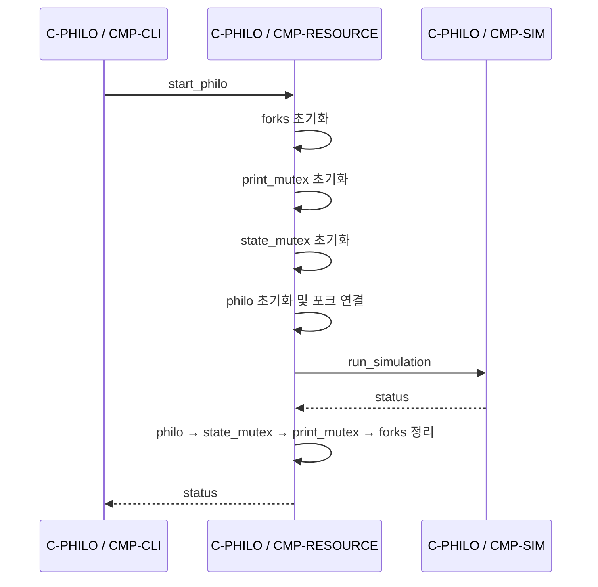

# F-RESOURCE · 자원 수명주기

상태: 부분 구현 · Container: [C-PHILO](../containers/philo.md)

## 트리거와 사전 조건

입력 검증 성공 후 `start_philo`가 호출된다. `t_data`의 포인터는 초기화되어 있고 `philo_cnt`는 양수여야 한다.

## 현재 순서

`with_resource`는 테이블을 재귀 순회한다. 초기화에 성공한 단계만 재귀 반환 시 정리한다. `init_forks`는 배열 크기 오버플로와 할당 실패를 검사하고, mutex 초기화 도중 실패하면 이미 초기화한 mutex만 파괴하고 배열을 해제한다. `init_philos`도 크기와 할당 실패를 검사한다.

## 실패와 소유권

초기화 함수는 실패한 자신의 부분 자원을 정리한다. `with_resource`는 그 이전에 성공한 단계들을 역순 정리한다. 예를 들어 `state_mutex` 초기화 실패 시 `print_mutex`, `forks`만 정리한다.

실행 단계 이후 정리의 사전 조건은 모든 worker가 공유 자원을 더 이상 사용하지 않는 것이다. 현재 `run_simulation`은 즉시 0을 반환하므로 worker를 생성하지 않는다. 스레드 실행을 연결할 때 이 조건을 반드시 구현해야 한다.

## 검증 기준

각 초기화 단계 실패, 포크 배열 중간 mutex 초기화 실패, 정상 종료 시 역순 해제, 실행 실패 시 스레드 회수 후 해제를 확인한다. 검증 상태: 정적 확인만 수행.
