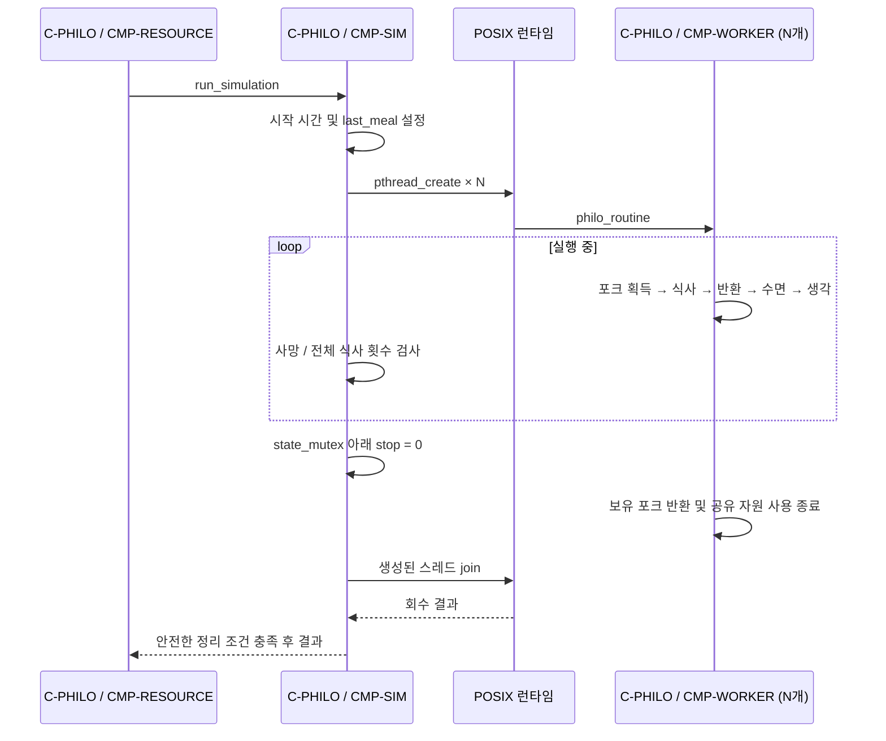

# F-SIM · 철학자 실행

상태: 설계 · Container: [C-PHILO](../containers/philo.md)

## 트리거와 사전 조건

자원 초기화가 완료되면 CMP-RESOURCE가 `run_simulation`을 호출한다. 목표는 철학자별 pthread를 실행하고 사망 또는 전체 식사 목표 달성까지 감시하는 것이다. 현재 `run_simulation`은 0 반환뿐이며 worker 루틴은 미구현이다.

## 참여 Component

- [Container 설계](../containers/philo.md)의 CMP-SIM이 메인 스레드에서 CMP-MONITOR 호출.
- CMP-WORKER는 CMP-TIME으로 시각·대기 처리, CMP-LOG로 일반 상태 출력.
- CMP-MONITOR는 CMP-TIME으로 시각 조회, CMP-LOG와 사망 종료·출력 조정.
- 아래 시퀀스의 SIM은 실행 조정과 감시 호출을 함께 표시. 세부 잠금·함수 계약은 미확정.

## 목표 상호작용

## 행동 계약

- 식사 때 두 포크를 독점하고 `last_meal`, `meal_cnt`를 보호된 상태로 갱신한다. 갱신 시점은 구현 전에 정한다.
- 데드락을 피하는 포크 획득 순서와 정지에 응답하는 대기 방식을 구현 전에 정한다.
- 철학자가 한 명이면 양쪽 포크가 같다. 동일 mutex를 두 번 잠그지 않으며 사망·정지 처리가 가능해야 한다.
- `must_eat=-1`이면 횟수 제한이 없다. 제한이 있으면 모든 철학자가 목표를 충족했을 때 정지한다.
- 로그는 `print_mutex`로 직렬화하고 종료 로그 이후 일반 로그가 출력되지 않도록 정지 판정과 함께 설계한다.

## F-STOP · 정지와 회수

상태: 부분 구현. `create_philo`, `join_philo`, `wait_released`의 골격만 존재하며 현재 미정의 변수와 오타가 있다.

1. 사망, 전체 식사 목표 충족, 생성 실패를 감지한다.
2. `state_mutex` 아래에서 실행 플래그 `stop`을 0으로 바꾼다.
3. worker가 대기에서 벗어나 보유 포크를 반환하고 종료하도록 한다.
4. 실제 생성에 성공한 스레드 수만큼 회수한다. 생성 실패 시 생성되지 않은 스레드를 join하지 않는다.
5. 공유 자원 접근 종료가 확인된 뒤 CMP-RESOURCE로 반환한다.

현재 `cleanup_created`는 생성 실패 경로에 연결되어 있지 않다. `join_philo`는 실패 시 `released`를 기다리려 하지만 worker가 이를 기록하는 구현이 없다. 따라서 현재 코드를 안전한 join 실패 처리로 간주하지 않는다. `released`만으로 pthread 회수 성공을 보장할 수도 없다.

## 구현 전에 확정할 계약

- 단조 시간원, ms 변환, 사망 판정의 `>=`/`>` 경계와 감시 주기.
- 식사 시작·완료 시각과 횟수 갱신 시점, worker 생성 중 시작 시각 처리.
- 포크 잠금 순서, state/print 잠금 순서, 정지 가능한 대기 방식.
- 로그 형식, 사망과 목표 달성이 동시에 관측될 때 우선순위.
- `released`가 보장하는 자원 접근 종료 범위, join 실패 시 회수 정책과 종료 코드.

## 검증 기준

구현 후 한 명, 여러 명, 사망 종료, 식사 목표 종료, 생성 중간 실패, join 실패 정책, 정지 중 대기 해제, 중복 사망 로그, 종료 후 로그, 데이터 경쟁·데드락·누수를 검증한다. 현재 실행 검증은 수행하지 않았다.
