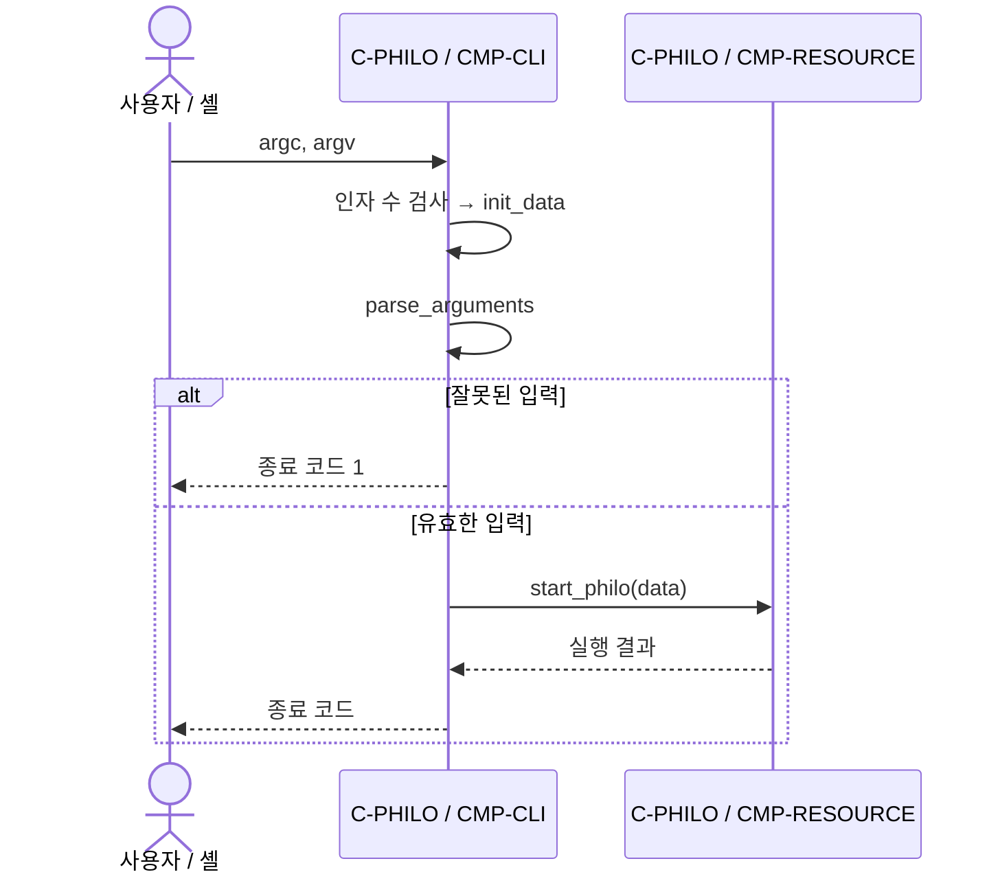

# F-START · 입력 검증과 시작

상태: 부분 구현 · Container: [C-PHILO](../containers/philo.md)

## 트리거와 사전 조건

사용자가 프로그램을 실행한다. `argc`는 실행 파일명을 포함해 5 또는 6이어야 한다.

## 현재 순서

파서는 선행 공백과 `+`를 허용하며 음수, 0, 빈 숫자, 숫자 뒤 공백·문자, `MAX_LLONG` 초과를 거부한다. 선택 인자 생략 시 `must_eat=-1`이다. 다섯 값은 모두 검증된 뒤 `t_data`로 복사된다. 파서는 호출자인 `main`이 인자 수를 검증한다는 전제를 가진다.

## 실패와 완료 조건

잘못된 인자는 자원 할당 전에 1로 종료한다. 성공 시 [F-RESOURCE](resources.md)로 진행한다. 현재 오류 메시지는 없다. `philo.h`의 `t_info` 선언은 실제 `t_data` 구현과 불일치하므로 실행 가능한 상태는 아니다.

## 검증 기준

구현 후 최소 인자 수 오류, 정상 네 개·다섯 개 인자, 0·음수·비숫자·오버플로, 선택 인자 생략을 확인한다. 검증 상태: 정적 확인만 수행.
