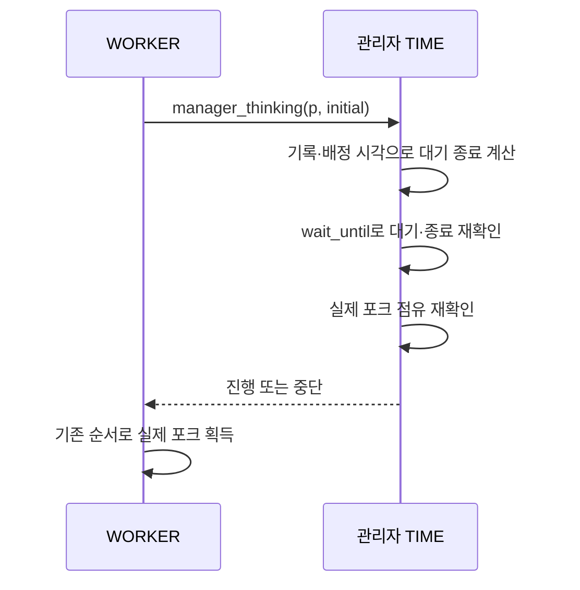

# F-ADAPTIVE · 관리자 생각 시간 배정

- 상태: 현재 구현. 사용자 승인으로 평가한 adaptive 후보를 프로젝트에 적용.
- Container: C-PHILO. 관리자 TIME 계산 → WORKER 대기·행동 보고. 기존 MONITOR·RESOURCE 흐름 유지.
- 기준: [개요](설계.md), [공통 계약](포크대기%20설계.md). 이 문서는 적용된 생각 시간 정책의 기준이며, 과거 실험 미채택 기록보다 우선.

## 트리거와 사전 조건

- 시작 동기화·기존 1ms 시작 시차 이후 `manager_thinking(p, 1)`.
- 수면 이후 `think_philo()`에서 생각 로그·상태 보고 후 `manager_thinking(p, 0)`.
- 철학자 실행부는 이웃을 조회하거나 시간을 계산하지 않음. 관리자 함수만 이웃 기록·배정 시각으로 계산.

## 참여자와 순서

- 구현: `simulation/manager_model.c`, `simulation/manager_plan.c`. 호출부는 `philo_routine.c`, `philo_actions.c`, 선언은 `philo.h`, 빌드 연결은 Makefile.
- N≥2에서 k=floor(N/2), B=max(ceil(N×eat/k), eat+sleep). B<die이면 P=B+min(25, floor((die-B)/2)).
- 초기 순위 r=((id-1)×ceil(N/2)) mod N, 최초 배정 시각=start+floor(r×P/N). 관리자가 전역 위상을 배치하며 고정 차례를 집행하지 않음.
- 이후 기준은 실제 last_meal+P. 이웃의 현재 식사 구간과 다음 예상 식사 구간을 피하는 시작 후보 선택.
- 유효한 THINKING/think_end는 이미 안내한 시각으로 우선 참고. 그 외 last_meal+P 또는 초기 배치 참고. 지금보다 지난 예상은 지금으로 보정.
- 기준·지금·생존 한계·이웃 구간 직전/직후 후보 중 겹치지 않고 기준에 가장 가까운 시각 선택. 동률이면 이른 시각.
- 생존 한계는 last_meal+die-2ms. 이미 지났으면 지금으로 보정. 가능한 후보가 없으면 한계 안의 기준 시각으로 후퇴하며 생존을 보장하지 않음.
- 한 번 안내한 다른 철학자의 대기는 수정하지 않음. 자신의 대기도 기다리는 도중 매번 목표를 새로 시작하지 않음.
- 기상 후 포크가 점유 중이면 기존 get_think_delay로 반납을 예상해 기다리고 실제 점유를 재확인. 이 경로는 점유자의 이후 식사를 연쇄 예측했던 과거 precheck 후보와 다름.
- N=1, 주기에 여유 없음, 주기 계산 오버플로이면 기존 생각 예측·제한적 양보 사용. 초기 배정은 건너뜀.

## 상태 변경과 동기화

- 관리자 계산·공유 action/think_end 읽기·쓰기는 state.mx 아래. 대기·출력은 잠금 밖.
- 기존 wait_until이 실제 종료·가장 오래된 후보의 사망 시각·목표 종료 확인 간격을 관리.
- 두 포크 예약·요청 큐·식사 허가·진행 중 식사/수면 단축 없음. 확인 직후 실제 획득까지 경쟁 가능.
- 추가 동적 할당 없음. 기존 재귀 초기화·역순 정리와 포크 획득 순서 유지.

## 실패와 완료 조건

- 반환 0은 다음 행동 진행, 1은 대기/실행 중단. 실제 사망 확정·출력은 기존 모니터.
- 주기 계산 불가 시 기존 정책으로 후퇴. 배정 시각/시계 오류는 stop_simulation 경로.
- 자원 확보 전 중단하면 worker 완료 경로. 실제 식사·포크 반환·종료 후 회수는 기존 경로.

## 검증 기준과 결과

- 평가한 바이너리와 적용 빌드 SHA256 일치 확인.
- 적용 전 평가지 실행/추가 입력 61/61, 입력 오류 7/7 통과. 2명 사망 지연 로그 기준 30회 0~1ms.
- Helgrind/DRD/Memcheck 수행 경로 오류 0. 할당·mutex 초기화·스레드 생성 실패 주입 11개 정상 정리.
- 적용 전 평가 보고서: `/tmp/philo-eval-adaptive-3v9u_3ti/REPORT.md`.
- 적용 직후 회귀 검사 결과는 `/tmp/philo-applied-adaptive-current`가 가리키는 디렉터리의 results.json/REPORT.md 참조.
- Norm·Libft 정리는 사용자 담당으로 유지. 이번 적용에서 수정하지 않음.

## 미확인 범위

- 모든 입력·OS 실행 순서에서 기아 방지 보장 없음. CPU 추가 개선·과제의 중앙 시간 조율 해석 적합성은 이번 적용만으로 확정하지 않음.
- 기존 시작 시차·식사/수면/사망 처리·음수와 0 거부 정책 유지.
