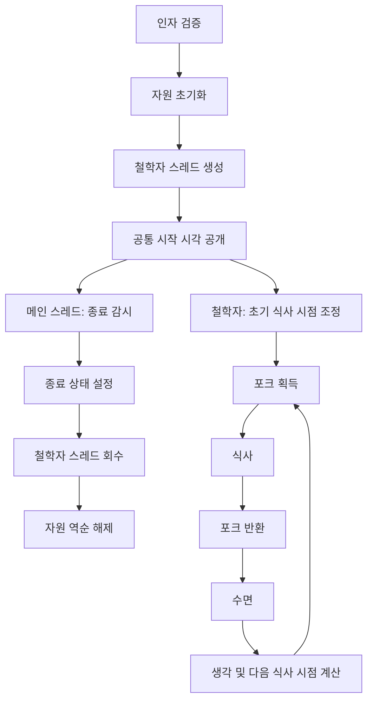

# Philosophers 구조와 설계 분석

이 문서는 2026-11-07 작업 트리의 현재 구현을 기준으로 작성했다.
구현된 동작과 그 설계 의도를 설명하며, 모든 입력에 대한 생존이나 실시간 성능을 검증했다는 의미는 아니다.

## 1. 설계 개요

현재 구현은 **포크를 안전하게 획득하는 동기화 구조 위에, 이웃의 식사 시간을 예측해 경쟁을 줄이는 일정 조정 기능을 올린 구조**다.

철학자마다 독립적인 스레드를 실행하고, 포크 뮤텍스로 자원 접근을 제어한다.
각 철학자는 공유 상태를 참고해 다음 식사 시점을 계산하며, 메인 스레드는 사망과 식사 목표 달성을 감시한다.

`manager`라는 이름의 함수들이 있지만 별도의 관리자 스레드는 없다.
각 철학자 스레드가 manager 함수를 호출해 자신의 일정을 정한다.

| 위치 | 주요 책임 |
| --- | --- |
| [main.c](../main.c) | 인자 개수 확인과 프로그램 진입 |
| [philo.h](../philo.h) | 자료형과 함수 인터페이스 |
| [base/](../base/) | 파싱, 자원 관리, 시간, 대기, 출력 |
| [simulation/](../simulation/) | 스레드 수명, 행동, 포크 획득, 일정 계산 |
| [monitor/](../monitor/) | 사망 시한과 전체 종료 감시 |

## 2. 전체 실행 흐름



[philosophers.c](../simulation/philosophers.c)의 `run_simulation()`은 스레드를 모두 생성한 다음
`start_philos()`를 호출해 모든 철학자의 `last_meal`과 공통 `start_time`을 설정한다.
먼저 생성된 스레드는 [philo_routine.c](../simulation/philo_routine.c)의 `wait_start()`에서 기다린다.

이 시작 장벽은 스레드 생성 순서에 따라 굶주림 시간이 먼저 흐르는 문제를 줄인다.
시작 기준 시각을 공유한다는 의미이며 실제 CPU 실행 시각까지 같아지는 것은 아니다.
초기 경쟁을 줄이기 위해 `time_to_die > 2`일 때 짝수 ID는 추가로 1ms를 기다린다.

## 3. 데이터 구조와 소유권

데이터는 설정, 공유 실행 상태, 철학자별 상태로 나뉜다.

| 자료형 | 역할 | 핵심 데이터 |
| --- | --- | --- |
| `t_data` | 전체 자원의 소유자 | 설정, 공유 상태, 철학자 배열, 포크 배열 |
| `t_share` | 실행 중 변경하지 않는 설정 | 인원수, 식사·수면·사망 시간, 목표 식사 횟수 |
| `t_state` | 공유 실행 상태 | 시작 시각, 실행 여부, 목표 달성 인원, `oldest`, 포크 상태 |
| `t_philo` | 철학자별 실행 정보 | 스레드, 마지막 식사 시각, 식사 횟수, 행동, 다음 예정 시각 |
| `t_fork_state` | 포크 관측 정보 | 소유자, 소유자의 식사 시작 시각 |
| `t_plan` | 일정 계산용 임시 데이터 | 충돌 구간, 후보 시각, 목표 시각, 최신 허용 시각 |
| `t_resource` | 자원 수명 관리 | 초기화 함수와 해제 함수의 쌍 |

`t_philo.share`는 `const t_share *`로 설정을 읽기 전용으로 참조한다.
각 철학자는 `state` 포인터로 공통 실행 상태에 접근한다.

포크는 두 가지 표현을 가진다.

- `pthread_mutex_t`: 실제 포크 사용 권한을 제어한다.
- `t_fork_state`: 누가 사용 중이며 언제 반환할지 예측하는 데 사용한다.

관측 정보는 사용 권한을 부여하지 않는다. 포크가 비어 있다고 관찰한 뒤에도 다른 스레드가 먼저 획득할 수 있다.

## 4. 자원 수명 관리

[base/resource.c](../base/resource.c)의 `start_philo()`는 초기화·해제 함수 쌍을 배열로 정의한다.
`with_resource()`는 다음 단계로 재귀 호출하고, 복귀하면서 현재 단계의 자원을 해제한다.

```text
포크 초기화
  공유 상태 뮤텍스 초기화
    출력 뮤텍스 초기화
      철학자 배열 할당
        개별 meal 뮤텍스 초기화
          포크 관측 배열 할당
            시뮬레이션 실행
          포크 관측 배열 해제
        meal 뮤텍스 해제
      철학자 배열 해제
    출력 뮤텍스 해제
  공유 상태 뮤텍스 해제
포크 해제
```

중간 초기화가 실패하면 성공한 앞 단계만 복귀 과정에서 정리된다.
실패한 초기화 함수는 자신의 단계에서 부분적으로 생성한 자원을 직접 정리한다.
이 방식은 초기화 순서와 역순 해제를 함수 테이블 및 호출 스택으로 연결한다.

스레드 생성이 중간에 실패하면 실행 상태를 종료로 바꾸고 이미 생성된 스레드를 회수한다.
정상 실행에서도 스레드 회수 후 자원을 해제한다.

## 5. 포크 획득과 교착 상태 방지

[simulation/forks.c](../simulation/forks.c)에서 철학자 ID가 `id`일 때 사용하는 포크 인덱스는 다음과 같다.

```c
left = id - 1;
right = id % philo_cnt;
```

일반 철학자는 왼쪽부터, 마지막 철학자는 오른쪽부터 잡는다.
배열 인덱스로 풀면 모두 낮은 인덱스부터 높은 인덱스 순서로 획득한다.

5명일 때 획득 순서는 다음과 같다.

```text
철학자 1: 0 → 1
철학자 2: 1 → 2
철학자 3: 2 → 3
철학자 4: 3 → 4
철학자 5: 0 → 4
```

모든 획득 경로에서 같은 순서를 지켜 포크 사이의 순환 대기를 방지한다.
일정 예측이 어긋나더라도 교착 상태 방지의 기반은 이 획득 순서다.
일정 조정은 경쟁과 대기 시간을 줄이는 역할을 맡는다.

철학자가 한 명이면 양쪽 포크 포인터가 같은 뮤텍스를 가리킨다.
`single_philo()`는 포크 하나만 잡고 종료를 기다려 같은 뮤텍스를 두 번 잠그지 않는다.

## 6. 생각 단계와 기본 식사 주기

이 구현에서 생각은 고정 시간 대기가 아니다.

```text
기본 식사 주기 계산
    ↓
이웃의 식사 예정 구간을 피하도록 시작 시각 선택
    ↓
예정 시각에 실제 포크 상태 재확인
```

관련 파일의 책임은 다음과 같다.

| 파일 | 책임 |
| --- | --- |
| [manager_model.c](../simulation/manager_model.c) | 기본 주기, 초기 시각, 이웃 충돌 구간 계산 |
| [manager_select.c](../simulation/manager_select.c) | 후보 생성 및 다음 식사 시작 시각 선택 |
| [manager_plan.c](../simulation/manager_plan.c) | 일정 적용, 대기, 실제 포크 상태 재확인 |
| [think.c](../simulation/think.c) | 포크 반환까지 남은 시간 추정 |
| [thinking_control.c](../simulation/thinking_control.c) | 행동 갱신, 생각 대기, 이웃 양보 |

### 기본 주기

인원수 `N`, 식사 시간 `E`, 수면 시간 `S`, 사망 시간 `D`에 대해 다음과 같이 계산한다.

```text
K = floor(N / 2)
base = max(ceil(N × E / K), E + S)
period = base + min(floor((D - base) / 2), 25)
```

- `K`: 동시에 식사할 수 있는 최대 인원이다.
- `ceil(N × E / K)`: 전체 식사 처리량에 기반한 주기 하한이다.
- `E + S`: 한 철학자가 식사와 수면을 마치는 데 필요한 시간이다.
- 추가 여유: 사망 시간까지 남은 여유의 절반이며 최대 25ms다.

이 값은 일정 조정의 기준이다. OS 스케줄링 지연까지 포함해 생존을 보장하는 공식은 아니다.
`K == 0`, 검사 대상 산술의 범위 초과, `base >= D`이면 `period = 0`을 반환하고 대체 경로를 사용한다.

### 초기 시작 시각

```text
rank = ((id - 1) × ceil(N / 2)) % N
start = simulation_start + floor(rank × period / N)
```

홀수 인원에서는 각 철학자의 `rank`가 서로 다르게 분산된다.
짝수 인원에서는 두 그룹으로 나뉜다.

```text
N = 4: rank = 0, 2, 0, 2
N = 5: rank = 0, 3, 1, 4, 2
```

서로 다른 rank라도 밀리초 단위 정수 나눗셈으로 실제 시작 시각이 같아질 수 있다.
따라서 모든 철학자에게 항상 서로 다른 시작 시각을 배정하는 방식은 아니다.

## 7. 충돌 구간을 이용한 다음 식사 시각 선택

`manager_select_start()`는 다음 값을 출발점으로 사용한다.

```text
목표 시각 = 마지막 식사 시작 + period
최신 허용 시각 = max(현재 시각, 마지막 식사 시작 + time_to_die - 2ms)
```

목표 시각을 현재 시각과 최신 허용 시각 사이로 제한하고 양옆 이웃의 식사 구간을 수집한다.
현재 시각이 이미 사망 시한에 도달했다면 이 제한 자체가 생존 가능성을 회복시키지는 않는다.

### 이웃의 식사 구간 예측

이웃 한 명당 최대 두 구간을 수집한다.

1. 현재 진행 중인 식사 구간.
2. 다음 식사로 예측되는 구간.

다음 식사 시각은 유효한 `think_end`가 있으면 그 값을 우선 사용한다.
그렇지 않으면 식사 이력이 있거나 식사·수면 중일 때 `last_meal + period`를 사용하고,
첫 식사 전에는 초기 시작 시각을 사용한다. 과거로 계산된 값은 현재 시각으로 보정한다.

양옆 이웃을 합쳐 `blocked`는 최대 4개다. 2명일 때는 동일한 이웃을 중복 수집하지 않는다.

### 후보 생성과 선택

후보 시각은 최대 11개다.

```text
목표 시각
현재 시각
최신 허용 시각
각 충돌 구간 시작 - 내 식사 시간
각 충돌 구간 끝
```

구간 경계에서 후보를 만드는 이유는 충돌 직전에 식사를 끝내거나 직후에 시작하기 위해서다.
모든 밀리초를 탐색하지 않고 의미 있는 경계 시각을 비교한다.
식사 구간은 경계가 맞닿는 경우를 허용한다.

유효한 후보 중 목표 시각에 가장 가까운 것을 선택하며, 거리가 같으면 더 이른 시각을 선택한다.
충돌 없는 후보가 없으면 제한된 목표 시각을 그대로 반환한다.

이 기능은 예측 기반 조정이다. 다른 철학자의 이후 결정이나 실제 실행 지연으로 일정이 달라질 수 있다.
예정 시각 이후 `check_forks_again()`으로 관측 상태를 재확인하고,
최종 사용 권한은 `take_forks()`의 포크 뮤텍스 획득으로 결정한다.

### 주기를 계산할 수 없는 경우

초기 호출에서는 추가 일정 대기 없이 진행한다.
이후 생각 단계에서는 포크의 예상 반환 시간을 기다리고 `yield_think()`를 호출한다.

포크를 소유했지만 아직 식사를 시작하지 않은 경우에는 1ms 단위로 재확인할 수 있도록 지연을 잡는다.
양보 경로는 자신의 생존 여유가 있을 때, 자신보다 마지막 식사가 오래된 대기 중이거나
곧 생각을 마칠 이웃에게 최대 10ms 범위에서 양보한다.

## 8. 식사 기록과 사망 감시

식사는 다음 순서로 처리한다.

```text
WAITING 설정
→ 포크 두 개 획득
→ 종료 여부와 자신의 사망 시한 확인
→ EATING 설정 및 last_meal 갱신
→ 식사 시간 대기
→ 완료 횟수 증가
→ 포크 반환
```

[meal.c](../simulation/meal.c)의 `record_meal_start()`는 `state.mx`를 잡은 상태에서
종료 여부와 사망 시한을 검사하고 식사 시작을 기록한다.
이미 자신의 시한에 도달한 철학자가 새 식사로 `last_meal`을 갱신하지 않도록 한다.

`last_meal`은 식사를 시작할 때 갱신한다.
`meal_cnt`는 식사 시간을 끝까지 기다리고 실행 상태가 유지될 때 증가한다.
따라서 식사 시작과 식사 완료를 구분한다.

목표 횟수에 처음 도달할 때만 `full_count`를 증가시킨다.
목표를 채운 철학자도 전체 종료 전까지 계속 행동하고, 모든 철학자가 목표를 채우면 모니터가 종료한다.

### 가장 이른 사망 후보 유지

[meal_deadline.c](../monitor/meal_deadline.c)는 `oldest`로 마지막 식사가 가장 오래된 철학자를 유지한다.
모든 철학자의 `time_to_die`가 같으므로 가장 먼저 사망 시한에 도달하는 후보이기도 하다.

`oldest` 자신이 식사를 시작하면 전체 배열에서 새 최솟값을 찾는다.
다른 철학자가 식사할 때는 기존 `oldest`를 유지한다. 이 판단은 시간이 뒤로 가지 않는다는 전제에 기반한다.

| 작업 | 시간 복잡도 |
| --- | --- |
| 모니터의 사망 대상 확인 | `O(1)` |
| `oldest`를 다시 선택하는 식사 기록 갱신 | `O(N)` |
| 고정 크기 후보를 이용한 일정 선택 | 인원수에 대해 `O(1)` |

즉, 모니터가 반복적으로 전체 배열을 순회하는 대신 식사 기록 갱신 시 가장 이른 사망 후보를 유지한다.

## 9. 동기화, 대기, 종료

| 잠금 | 보호 대상 |
| --- | --- |
| 포크별 뮤텍스 | 실제 포크 소유권 |
| `state.mx` | 식사 시각·횟수, 행동, 예정 시각, 포크 관측 정보, 종료 상태, `oldest` |
| `state.print` | 로그 출력과 사망 로그의 순서 |

일반 출력과 사망 출력에서 두 잠금을 중첩할 때 순서는 `print → mx`다.
사망 판정은 출력 잠금을 잡은 상태에서 `stop = 0`을 설정하고 사망 로그를 남긴다.
이후 일반 출력은 종료 상태를 확인해 행동 로그를 출력하지 않는다.

[wait.c](../base/wait.c)의 대기는 요청한 행동 종료 시각과 가장 이른 사망 시한을 함께 고려한다.
상태 확인 시에만 `mx`를 잡고 `usleep()` 중에는 풀어둔다.
모니터가 요청하는 수면 시간은 최대 10ms지만 실제 관측 지연은 OS 스케줄링과 출력 상황의 영향을 받는다.

종료 시 철학자는 보유 포크를 반환하고 `released = 1`, `action = 0`을 기록한다.
메인은 `pthread_join()`으로 스레드를 회수한 뒤 자원을 정리한다.
join 오류가 발생한 경로에서는 `released`를 확인해 철학자가 공유 자원 사용을 마칠 때까지 기다린다.

## 10. 현재 구현을 설명할 때 구분할 점

- `meal` 뮤텍스는 생성·해제하지만 현재 실행 경로에서는 사용하지 않는다. 식사 정보는 `state.mx`가 보호한다.
- `stop`은 이름과 달리 `1`이 실행 중이고 `0`이 종료다.
- `gettimeofday()`를 사용하므로 시간 계산은 시스템 시각 변경의 영향을 받을 수 있다.
- 초기 rank 분산과 충돌 회피는 실제 CPU 실행 순서나 식사 시각을 확정하지 않는다.
- 일정 조정과 양보는 기아 가능성을 줄이려는 정책이며 엄격한 공정성이나 무기아를 증명하지 않는다.
- 교착 상태 방지, 경쟁 완화, 사망 감시는 서로 다른 책임이다. 각각 포크 획득 순서, 일정 조정, 메인 모니터가 담당한다.

이 구조를 설명할 때는 자원 수명 관리, 공유 데이터와 잠금, 포크 획득 순서,
식사 일정 조정, 사망 감시와 종료 순서로 읽으면 각 기능이 의존하는 기반을 먼저 파악할 수 있다.
